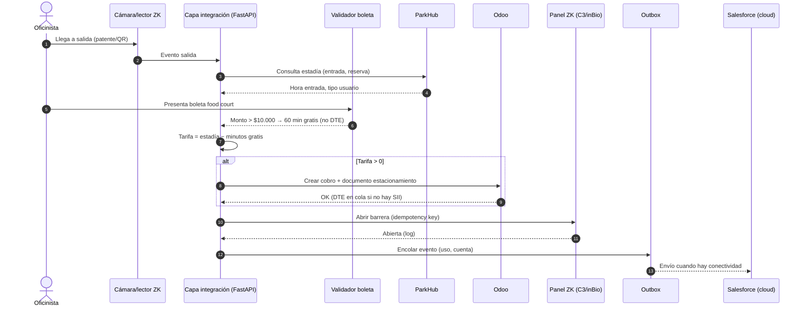

# 01 · Arquitectura

## Principio rector
**On-prem es la fuente de verdad de la operación.** La barrera, la validación de boleta y el cobro nunca dependen de internet. La nube (Salesforce) recibe datos de forma diferida y nunca bloquea la operación.

## Componentes y responsabilidades
| Componente | Responsabilidad | Ubicación |
|---|---|---|
| ParkHub (PHP o Rust) | Reservas, cupos, buffer de sobreventa, check-in QR, RBAC, audit log, webhooks salientes | On-prem |
| Odoo Community | Contabilidad, clientes/arrendatarios, órdenes de venta, documentos tributarios (ver [03](03-odoo-chile-tax.md) — módulos **a verificar**), conciliación de pagos | On-prem |
| Capa de integración (FastAPI) | Orquesta ParkHub ↔ Odoo ↔ ZK ↔ Salesforce; outbox; idempotencia; reintentos; reglas de conflicto; panel de sincronización | On-prem |
| Validador de boleta | OCR + fallback manual (PoC4); aplica regla > $10.000 → 30/60 min | On-prem (parte de la capa de integración o servicio aparte, a decidir) |
| Hardware ZK | Paneles C3/inBio deciden localmente con whitelist almacenada; barreras; cámaras | On-prem |
| Salesforce Developer Edition | Leads de operadores, cuentas de arrendatarios, oportunidades (demo) | **Cloud** |

## Flujo de una transacción
1. **Entrada:** el vehículo llega; ParkHub valida reserva/QR o cupo libre (capacidad + buffer). El panel ZK abre según su whitelist local.
2. **Boleta:** el usuario presenta la boleta del food court. El validador comprueba monto > umbral y asigna minutos gratis. *Esta boleta no genera DTE.*
3. **Salida:** se calcula la tarifa = tiempo − minutos gratis.
4. **Cobro:** si tarifa > 0 (más deuda previa, si existe), se cobra por Webpay. Si Webpay o la red fallan: **efectivo** o **salida con deuda** registrada en el libro de deudas local. Si tarifa = 0, se abre directo.
5. **DTE:** si hubo cobro, Odoo (módulo `l10n_cl_fe`, emisor = operador) emite el documento tributario del estacionamiento (o queda en cola si el emisor depende de internet/SII).
6. **Apertura:** la capa de integración ordena la apertura a ZK (PoC5), con audit log.
7. **CRM:** el evento agregado (p. ej. cuenta de arrendatario, uso) se encola en outbox hacia Salesforce.

## Roles
- **ParkHub:** reservas, slots, check-in, reglas de cupo; registro de entrada/salida (por integración).
- **Odoo:** contabilidad, boletas/facturas/DTE, conciliación Webpay, cuentas de arrendatarios.
- **Salesforce:** leads de operadores interesados, cuentas de arrendatarios, oportunidades de venta del servicio. Solo demo.

## Puntos de integración
| Origen → destino | Mecanismo | Fallback |
|---|---|---|
| ParkHub → capa | Webhooks salientes (Rust: "Webhooks v2" firmados HMAC-SHA256 según README; PHP: "outbound webhooks") | Polling REST / export CSV |
| Capa → ParkHub | REST API (Rust publica OpenAPI; PHP: endpoints **a verificar**) | Acción manual en UI |
| Capa ↔ Odoo | XML-RPC / JSON-RPC | Import CSV en Odoo |
| Capa ↔ ZK | PULL SDK (C3/inBio) o PUSH/ADMS | Relé / botón físico auditado |
| Capa → Salesforce | REST API vía outbox | Export CSV / Data Import Wizard |

## Diagrama de secuencia: oficinista sale con boleta validada

## Modo offline y sincronización diferida
Contexto: en Chile terremotos e incendios cortan telecomunicaciones; los generadores devuelven energía al estacionamiento e iluminación antes que vuelva internet.

- **Decisión local:** los paneles ZK deciden con whitelist almacenada; la capa de integración y ParkHub/Odoo están en la LAN.
- **Outbox / store-and-forward:** todo evento hacia la nube se escribe primero en una tabla outbox local (misma transacción que el cambio de negocio). Un worker lo envía cuando hay conectividad.
- **Claves de idempotencia:** cada evento lleva `event_id` (UUID) + `source` + `version`. En Salesforce se usa un campo External ID para upsert (evita duplicados).
- **Reintentos con backoff:** exponencial con jitter (p. ej. 5 s → 10 min tope), sin límite de intentos para eventos de negocio; dead-letter tras N errores no transitorios (4xx de validación).
- **Reglas de conflicto:** on-prem gana en datos operativos (estadías, cobros, aperturas, cuentas en Odoo). Salesforce gana solo en campos comerciales propios (etapa de Opportunity, notas de venta). Conflictos se registran, no se sobrescriben en silencio.
- **Orden:** por agregado (`aggregate_id`) se respeta el orden de secuencia; entre agregados se paraleliza.
- **Panel de estado de sync:** pendientes, enviados, fallidos, antigüedad del evento más viejo, último contacto exitoso con cada destino.
- **SII/DTE offline:** el envío de DTE al SII requiere internet; se encola igual. Plazos legales de envío: **a verificar** con el contador.
- Métricas de validación en PoC7 ([06](06-poc-plan.md)).

## Libro de deudas local
Cuando Webpay o la red no están disponibles, el cliente puede pagar en efectivo o **salir con deuda**.
- Tabla local `debt_ledger(debt_id, plate, parkhub_user_id, amount_clp, stay_id, created_at, reason, booth_operator, status, paid_at, payment_ref)` en el PostgreSQL de la capa de integración.
- Clave de búsqueda: patente y/o usuario ParkHub. En la siguiente salida la capa suma la deuda a la tarifa.
- Al volver la sync: cada deuda y su pago se envían a Odoo vía outbox (cuenta por cobrar "Deudas de estacionamiento"), con `debt_id` como clave de idempotencia.
- Límite configurable de deuda por patente; anulación solo admin, con audit log.
- Riesgos: ver [07-risks.md](07-risks.md) (R-01, R-02, R-07). Historia: `backlog-drafts/hu-libro-deudas-local.md`.
